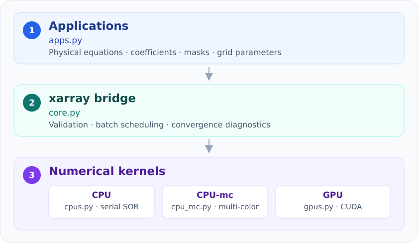
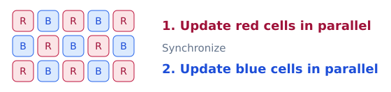

.. xinvert architecture documentation

Architecture
============

xinvert solves elliptic equations with successive over-relaxation (SOR).  The
same high-level applications can run on three backends: 1) a numba CPU backend;
2) an experimental multi-color (multi-core) CPU backend; and 3) a CUDA GPU
backend, while retaining xarray dimensions, coordinates and batching.

This page describes the classical SOR inversion path. Helmholtz shares the
xarray interface, with a separate least-squares implementation for Li2006.
Li loads its input slices during the call; Helmholtz SOR requires one eager 2-D slice.

Three-layer design
------------------

For example, ``invert_Poisson`` first constructs the equation coefficients in
``apps.py``.  ``core.py`` then applies the selected low-level solver over the
requested spatial dimensions with ``xarray.apply_ufunc``.  Dimensions not
listed in ``dims`` (for example ``time`` or ``member``) are independent batch
dimensions and are preserved in the result.

Selecting a backend
-------------------

The backend is selected simply through the inversion parameter as
``iParams['architect']='cpu'``.

.. code-block:: python

    # single CPU core (default)
    streamfunction = invert_Poisson(vorticity, dims=['lat', 'lon'])

    # Multi-color (multi-core) CPU
    streamfunction = invert_Poisson(vorticity, dims=['lat', 'lon'],
        iParams={'architect': 'cpu-mc'},
    )

    # single GPU
    streamfunction = invert_Poisson(vorticity, dims=['lat', 'lon'],
        iParams={'architect': 'gpu'},
    )

CPU thread counts
-----------------

Multi-color SOR (as well as Li2006's algorithm in Helmholtz decomposition) uses
``iParams['threads']=None`` to control the threads for ``architect='cpu-mc'``.
The default ``None`` inherits the current Numba setting (not necessarily single
thread). Importing xinvert does not change the global Numba setting. An integer
overrides it **temporarily**; the previous setting will be restored after inversion,
including on exceptions. This controls parallelism within each spatial solve;
independent time/member slices can additionally use Dask parallelism.

.. code-block:: python

    # Default: inherit the executing thread's Numba setting.
    streamfunction = invert_Poisson(vorticity, dims=['lat', 'lon'],
        iParams={'architect': 'cpu-mc'},
    )

    # Override only this solve, using 8 threads for parallel CPU computing.
    # each lat/lon inversion for a single timestep will use 8 threads.
    streamfunction = invert_Poisson(vorticity, dims=['lat', 'lon'],
        iParams={'architect': 'cpu-mc', 'threads': 8},
    )

.. note::
    Valid values must be positive integers and no greater than
    ``numba.config.NUMBA_NUM_THREADS``. Setting a numba threads in the main
    thread does not configure Dask worker threads. For lazy/Dask solves prefer
    an explicit integer, which is applied inside each executing worker. Concurrent
    slices each receive that many threads.
    The setting does not control BLAS, SciPy vector operations, or GPU blocks.
    Ordinary SOR ``architect='cpu'`` remains serial and ignores the thread count.

CPU and GPU implementation
--------------------------

Classical SOR uses newly updated neighbouring values and is therefore serial
on a single CPU core. The ``cpu-mc`` and GPU backends partition the stencil
dependency graph into colors. Every point of one color can update concurrently,
followed by a synchronization before the next color:

xinvert selects the coloring from the active stencil:

* two colors for five-point 2-D and seven-point 3-D operators;
* four colors when a 2-D mixed derivative couples diagonal neighbours;
* five colors on GPU and nine colors on CPU-mc for the biharmonic stencil,
  which couples points up to two cells away in each direction.

.. list-table::
   :header-rows: 1
   :widths: 22 39 39

   * - Aspect
     - CPU
     - GPU
   * - Implementation
     - numba ``@njit``
     - numba ``@cuda.jit`` kernels with a Python loop
   * - SOR ordering
     - lexicographic, point by point
     - dependency-safe multi-color sweeps
   * - Parallelism
     - one spatial solve per CPU kernel call
     - grid points of one color update in parallel
   * - Data location
     - NumPy host arrays
     - CUDA device arrays during the solve
   * - Batch dimensions
     - vectorized by xarray/Dask
     - Same except GPU solves are serialized per process

The CPU and GPU (CPU-mc) algorithms use different update orderings, so their
intermediate iteration paths are not bitwise identical.  They solve the same
discrete equation and use the same residual stopping definition.  Numerical
agreement is covered by the corresponding ``tests/test_Gpu*.py`` tests.  See
:doc:`Benchmark` for measured performance and accuracy.

For SOR inversions with Dask-backed inputs, non-spatial slices remain lazy until
``compute()``, writing, or plotting is requested.  GPU solves are limited to
one at a time per process because concurrent default-stream solves increase
VRAM use without improving throughput.  Dask can still overlap surrounding I/O
and scheduling. Multi-GPU are not well tested currently.

.. important::

   With ``BCs`` specifying ``'periodic'`` in x, the number of x grid points
   must preserve the backend's coloring:

   * Second-order equations: GPU and CPU-mc require an even x length.
   * Biharmonic equations (e.g. Stommel--Munk): GPU requires a multiple of
     five; CPU-mc requires a multiple of three.

   An incompatible length raises ``ValueError`` before iteration begins;
   Choose a compatible grid or return to ``iParams['architect'] = 'cpu'``,
   which has no coloring restriction. These constraints **apply only to periodic x**,
   not fixed or extend boundaries.

Optimal SOR relaxation factor
-------------------------------

``iParams['optArg']`` sets the optimal argument/factor for SOR and affects
the convergence rate.  When ``iParams['optArg']`` is ``None``, xinvert estimates
`Young's optimal SOR factor <https://doi.org/10.1016/C2013-0-11733-3>`_
:math:`\omega` from the spectral radius of an anisotropic, constant-coefficient
Jacobi model:

.. math::

    \omega = \frac{2}{1+\sqrt{1-\rho_J^2}}, \qquad
    \rho_J = \frac{\sum_d h_d^{-2}\cos\theta_d}
                   {\sum_d h_d^{-2}}.

Here :math:`h_d` is the grid spacing in direction :math:`d`, and :math:`N_d`
is the total number of grid points including boundaries. For an all-fixed
model, :math:`\theta_d=\pi/(N_d-1)`; other boundary combinations use
the corresponding constant/nonconstant modes in the estimate.

Note that the expression is exact only for the separable constant-coefficient
model with ``fixed`` BCs; for most of the real applications, it is **an estimate**
with variable coefficients, complex land/sea masks, mixed derivatives and
``periodic`` BCs. For multi-timestep inversions on a fixed grid and BCs, it is
recommended to find a 'best' ``iParams['optArg']`` through several tests, probably from
the initial guess of Young's optimal value, before starting the batch inversions.

.. tip::
    Passing ``iParams={'debug':True, 'optArg':None}`` will show Young's value through
    debug printing.

Numerical precision
-------------------

``iParams['dtype']`` controls the solver's floating-point precision:

* ``None`` (default): follow forcing's ``dtype``.
* ``'float32'`` or ``'float64'``: convert the input, solve and return the
  solution in the requested precision. Float32 uses less memory.

With ``None``, float16 and integer forcings use float64. Helmholtz follows both
``u`` and ``v``: float32 is used when both are float32, otherwise float64. Coordinates
retain their own precision; initial and boundary values are cast to the solve dtype.
Scalar diagnostics may use float64 accumulation. Attainable accuracy and speed depend
on the problem and backend.

Residual checks and diagnostics
-------------------------------

CPU and GPU stop on the same normalized residual or error.
Checks use an automatic interval unless ``iParams['diag_interval']`` is given.
A positive value indicates that the residual/error history is sampled every
`diag_interval` steps, and will be returned as an ``xarray.Dataset`` along with
the result.  The residual definition, interval behavior, Dataset
layout and plotting examples are documented in :doc:`Diagnostics`.

``iParams['tolerance']`` sets the stopping threshold for the SOR residual/error:
smaller values request tighter convergence and usually more
iterations. If ``mxLoop`` is reached first, the solve will stop and may not reached
the given tolerance.

File structure
--------------

.. code-block:: text

    xinvert/
    |-- helmholtz/           # decomposition interfaces
    |   |-- __init__.py      # shared xarray interface and diagnostics
    |   |-- _sor.py          # one potential, SOR and C-grid operators
    |   |-- _li2006.py       # joint potential fitting and CPU operators
    |   `-- _li2006_gpu.py   # GPU least-squares implementation
    |-- __init__.py          # package exports
    |-- apps.py              # physical equations and coefficients
    |-- animate.py           # streaming iteration frames
    |-- core.py              # xarray bridge and diagnostics
    |-- cpus.py              # serial CPU kernels
    |-- cpu_mc.py            # multi-core CPU kernels
    |-- gpus.py              # CUDA kernels and iteration loops
    |-- _neumann.py          # shared masked Neumann assembly and SOR
    |-- _neumann_gpu.py      # CUDA kernels for masked Neumann equations
    |-- domain.py            # connected regions, masks and internal boundary faces
    |-- finitediffs.py       # independent derivative utilities
    `-- utils.py             # flow diagnostics, thread controls and utilities
