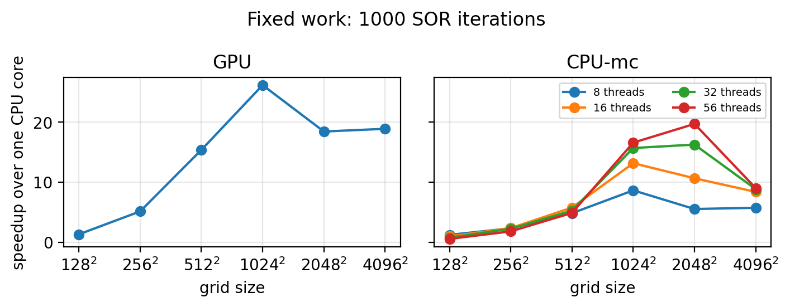
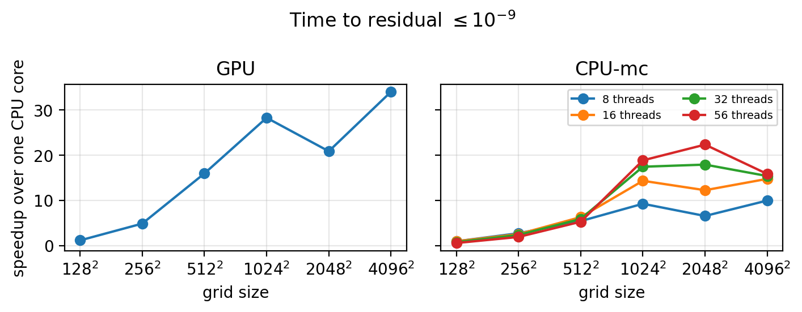
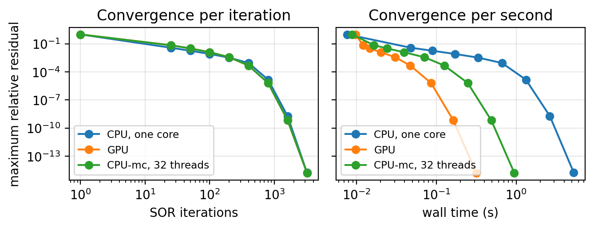

Benchmarks
==========

The benchmarks answer three questions in sequence:

1. How quickly can each backend execute the same number of SOR iterations?
2. How quickly can each backend reach the same residual tolerance?
3. Does any time difference come from convergence per iteration, execution
   speed, or both?

They measure performance, not numerical correctness. Correctness, boundary
behavior, and agreement between backends belong in the test suite.

Experimental setup
------------------

Every backend solves the same two-dimensional Cartesian Poisson problem,

.. math::

    \nabla^2\psi=-2\pi^2\sin(\pi x)\sin(\pi y),

on square grids from :math:`128^2` through :math:`4096^2`. All calculations
use ``float64``, fixed boundaries, a zero initial state, and the same automatic
SOR relaxation-factor policy. Backends are warmed up before timing, so Numba
compilation and CUDA context creation are excluded. Timings otherwise cover
the complete public API call; GPU timings include transfers and
synchronization.

Results were measured on 9 October 2026 with an Intel Xeon w9-3495X (56
physical cores, 112 logical threads) and an NVIDIA GeForce RTX 3090. The
software environment used Python 3.13.7, NumPy 2.2.5, xarray 2025.4.0, Numba
0.61.2, and NVIDIA driver 580.65.06. The machine was otherwise idle. Runs
through :math:`1024^2` use medians of five samples; :math:`2048^2` and
:math:`4096^2` use medians of two samples. CPU-mc was restricted to physical
cores 0--55, without simultaneous multithreading.

All acceleration panels use the same reference: xinvert's lexicographic CPU
backend restricted to one core. They also use the same x axis (grid size) and
y axis (speedup), so GPU and CPU-mc results can be compared directly.

Fixed-work throughput
---------------------

The first experiment sets ``tolerance=0`` and forces every backend to execute
exactly 1000 SOR iterations. It measures stencil throughput without mixing in
differences in convergence paths.

   Fixed-work acceleration. GPU has one curve because its CUDA launch
   configuration is internal; CPU-mc has one curve per requested Numba thread
   count.

Small grids contain too little work to amortize parallel scheduling and GPU
launch costs. CPU-mc therefore can be slower than the single-core reference at
:math:`128^2`. Larger grids expose more parallel work, but CPU-mc eventually
shows diminishing returns consistent with memory-bandwidth limits. A
``float64`` field occupies about 32 MiB at
:math:`2048^2` and 128 MiB at :math:`4096^2`, while the benchmark machine has
105 MiB of shared L3 cache. At :math:`4096^2`, even one full field exceeds L3
and the solver accesses several fields. Cache capacity, memory bandwidth, and
thread synchronization are plausible contributors to the weaker scaling at
:math:`4096^2`; timings alone do not identify their individual contributions.

Time to residual
----------------

The second experiment measures end-to-end time to a maximum relative residual
no larger than :math:`10^{-9}`. Unlike fixed work, this result includes both
iteration throughput and any difference in the number of iterations required
by the solver ordering.

   End-to-end acceleration for reaching residual :math:`\leq 10^{-9}`. Axes
   and baseline are identical to the fixed-work figure.

CPU-mc thread count is deliberately shown as multiple curves rather than as a
separate thread-scaling plot. This makes two facts visible at once: the useful
thread count grows with grid size, and adding threads beyond the bandwidth or
scheduling limit can reduce performance.

Residual convergence
--------------------

The final experiment explains the time-to-residual result on a representative
:math:`512^2` grid.

   Residual versus iteration (left) separates solver-ordering behavior from
   hardware speed. Residual versus wall time (right) shows practical
   convergence speed.

The lexicographic CPU solver and the multi-color GPU/CPU-mc solvers do not
necessarily follow the same iteration path. The left panel therefore answers
whether one ordering reduces residual faster per iteration. The right panel
combines that algorithmic behavior with hardware throughput. CPU-mc uses 32
threads in this diagnostic so that all three available execution strategies
appear in the same comparison.

Reproducing the results
-----------------------

Run benchmarks only on an otherwise idle machine. These commands create the
three raw JSON files and regenerate all public figures:

.. code-block:: bash

    taskset -c 0-55 python benchmarks/benchmark_cpu_gpu.py \
        --mode fixed --architectures cpu gpu \
        --grids 128 256 512 1024 2048 4096 --fixed-iterations 1000

    taskset -c 0-55 python benchmarks/benchmark_cpu_gpu.py \
        --mode converged --architectures cpu gpu \
        --grids 128 256 512 1024 2048 4096 --tolerance 1e-9

    taskset -c 0-55 python benchmarks/benchmark_cpu_mc.py
    python benchmarks/plot_benchmarks.py

Raw measurements are stored in ``benchmarks/results/fixed_work.json``,
``time_to_tolerance.json``, and ``cpu_mc.json``. The JSON metadata records the
dtype, tolerance, iteration count, repeat policy, and CPU-mc thread
configuration required to reproduce or extend the measurements.
