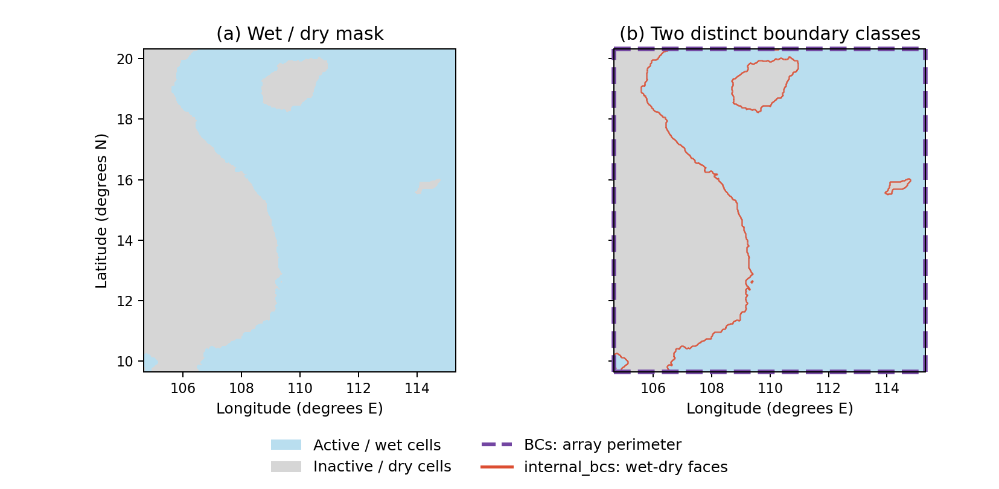

Boundary conditions
===================

xinvert has two related, but deliberately different, boundary-condition
interfaces:

* inversion routines use one scalar string per inversion dimension;
* :class:`xinvert.finitediffs.FiniteDiff` may specify the two endpoints of a
  dimension separately.

Inversion interface
-------------------

Pass ``iParams={'BCs': [...]}`` in the same order as ``dims``.  For example::

    psi = invert_Poisson(
        forcing,
        dims=['lat', 'lon'],
        iParams={'BCs': ['extend', 'periodic']},
    )

Each entry must be one of ``'fixed'``, ``'extend'``, or ``'periodic'``.
Capitalization and surrounding whitespace are normalized.  A two-dimensional
inversion therefore requires exactly two strings, and a three-dimensional
inversion requires exactly three strings.

``fixed``
    Keep the prescribed boundary value from ``icbc`` (or the initialized
    value when ``icbc`` is omitted).

``extend``
    Copy the adjacent interior value onto both boundaries of that dimension.
    The x and y dimensions are updated independently.  A corner is extended
    diagonally only when both adjoining dimensions use ``extend``; if either
    dimension is ``fixed``, that fixed corner is preserved.

``periodic``
    Wrap the stencil across the two ends of the dimension.  Periodic inversion
    is currently implemented only for x, the last inversion dimension.

Current support
---------------

.. list-table::
   :header-rows: 1
   :widths: 15 20 35 30

   * - Dimension
     - Implemented
     - Accepted but not implemented
     - Behaviour when not implemented
   * - x (last)
     - ``fixed``, ``extend``, ``periodic``
     - none
     - --
   * - y
     - ``fixed``, ``extend``
     - ``periodic``
     - emits ``RuntimeWarning``; the requested periodic update is not applied
   * - z (3-D)
     - ``fixed``
     - ``extend``, ``periodic``
     - emits ``RuntimeWarning``; the requested z update is not applied

The not-yet-implemented values remain accepted so that the public interface
does not need to change when their numerical kernels are added.  Do not rely on
their numerical result until the warning is removed in a future release.

External versus internal boundaries
----------------------------------------

``iParams['BCs']`` describes the array perimeter, in the same axis order as
``dims``. ``iParams['internal_bcs']`` describes active--inactive interfaces
inside that perimeter. A regional ocean can have fixed values at its open
outer edges and zero normal gradient along its coast.

The left panel shows the validity mask from one interpolated LLC4320 SSH
slice. The right panel marks the array perimeter in dashed purple and the
wet--dry interfaces in red. The purple frame identifies outer boundary
locations; it does not turn inactive edge cells into solved cells. A cropped
regional mask is used for illustration, not a native LLC mesh.

.. code-block:: python

   solution = invert_Poisson(
       forcing, dims=['lat', 'lon'],
       iParams={
           'architect': 'gpu',  # also 'cpu' and 'cpu-mc'
           'BCs': ['fixed', 'fixed'],
           'internal_bcs': 'neumann',
       },
   )

``'fixed'`` is the default and uses finite ``icbc`` values at inactive
neighbours, or zero when no boundary value is supplied.
``'neumann'`` removes the blocked face flux and its centre-coefficient
contribution. Topology is inferred automatically per spatial slice, including
changing time masks. A component without fixed-boundary connections requires
compatible zero-net forcing; see :doc:`DomainTopology` for the discrete
equation, gauge, and validation details. Internal Neumann supports Poisson,
PV2D, RefState, diagonal Eliassen, geostrophic, Bretherton--Haidvogel and Fofonoff on all
three backends. Components whose reaction term removes the constant
nullspace do not require zero-net forcing or a gauge shift. Nonzero mixed
coefficients, general first-derivative operators, 1-D/3-D,
fourth-order operators and animation remain unsupported and fail explicitly.
The generic low-level templates do not interpret this setting.

Initial guesses and missing values
----------------------------------

For a complete closed-domain face-vector decomposition built on this solver,
see :doc:`Projection`. It supports Cartesian and nonpolar regular lat-lon
grids, including periodic x, with consistent face-gradient/divergence operators.

When supplied, ``icbc`` is used as the initial guess on every valid grid point,
not only on fixed boundaries.  It may omit non-inversion dimensions: for
example, a ``(lat, lon)`` initial guess is broadcast over the ``time`` dimension
of a ``(time, lat, lon)`` forcing array.  All shared coordinates must match the
forcing exactly.

Grid points where the forcing is undefined are not updated. With default
internal fixed mode, neighbouring equations read their finite ``icbc`` values.
Absent, non-finite or undefined boundary values fall back to zero. The final
output at inactive cells is restored to the user-selected ``undef`` value.
With internal Neumann, those neighbour terms are
removed instead, so inactive values cannot affect the active solution.

Asymmetric endpoints belong to FiniteDiff
-----------------------------------------

The SOR inversion interface does **not** accept an endpoint dictionary or a
two-element endpoint pair inside ``iParams['BCs']``.  Such inputs raise a
``ValueError`` instead of being interpreted ambiguously.

For differentiation, :class:`xinvert.finitediffs.FiniteDiff` supports separate
lower-index and upper-index endpoints::

    fd = FiniteDiff(
        {'Y': 'lat', 'X': 'lon'},
        BCs={'Y': 'fixed', 'X': ('extend', 'fixed')},
        coords='lat-lon',
    )

For ``X``, the pair is ordered lower-index then upper-index, conventionally
west then east.  Thus the example extends the west boundary and fixes the east
boundary.  The same lower/upper ordering applies to other dimensions.

``cal_flow`` follows the simple interface
-----------------------------------------

:func:`xinvert.apps.cal_flow` also accepts exactly one boundary-condition
string per dimension and applies it to both endpoints.  It supports the four
conditions implemented by ``FiniteDiff``: ``'fixed'``, ``'extend'``,
``'reflect'``, and ``'periodic'``.  Unlike the SOR inversion routines, a
periodic y boundary is fully implemented here and does not emit the pending
kernel warning.

To use different endpoint conditions when calculating a derivative, construct
``FiniteDiff`` directly as in the example above.  Passing an endpoint pair or
dictionary to ``cal_flow`` raises ``ValueError`` rather than silently changing
its meaning.

Relationship to xarray
----------------------

``cal_flow`` delegates its spatial derivatives to ``FiniteDiff``.  For a
centered first derivative, ``FiniteDiff`` first creates one ghost point at
each endpoint with `xarray.DataArray.pad
<https://docs.xarray.dev/en/stable/generated/xarray.DataArray.pad.html>`_, then
evaluates the padded field with `xarray.DataArray.differentiate
<https://docs.xarray.dev/en/stable/generated/xarray.DataArray.differentiate.html>`_.
The xinvert boundary names map to xarray padding modes as follows:

.. list-table::
   :header-rows: 1

   * - xinvert BC
     - xarray ``pad`` mode
   * - ``fixed``
     - ``constant`` with the corresponding ``fill`` value
   * - ``extend``
     - ``edge``
   * - ``reflect``
     - ``reflect``
   * - ``periodic``
     - ``wrap``

These are xinvert boundary-condition names, not options accepted directly by
``DataArray.differentiate``.  The xarray method exposes ``edge_order`` rather
than physical boundary conditions and is limited to a one-dimensional
coordinate in Cartesian geometry.  Refer to the linked xarray API pages for
the underlying padding and differentiation behavior, while using the xinvert
names in ``FiniteDiff`` and ``cal_flow``.
