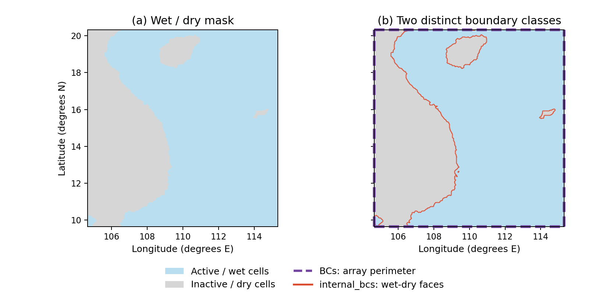
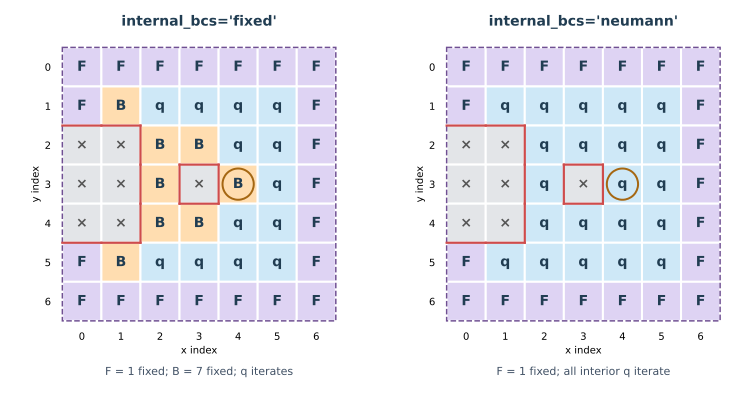

Boundary conditions
===================

The steady-state problems targeted by **xinvert** are all boundary-value problems.
So the types of the boundary condition (BC) affect the solution in a significant way.
One needs to choose a proper BC for the solution.

External versus internal boundaries
----------------------------------------

External boundary conditions are controlled by ``iParams['BCs']``, which describes
the array perimeter, in the same axis order as ``dims``.  Internal BCs are controlled
by ``iParams['internal_bcs']``, which describes active--inactive interfaces
inside that perimeter. A regional ocean can have fixed values at its open
outer edges and zero normal gradient along its coast.

The left panel shows the validity mask from a regional domain. The right
panel marks the array perimeter (external BCs) in dashed purple and the
wet--dry interfaces (internal BCs) in red.

External BCs interface
----------------------

Pass ``iParams={'BCs': [...]}`` in the same order as ``dims``.  For example::

    streamfunction = invert_Poisson(vorticity, dims=['lat', 'lon'],
        iParams={'BCs': ['extend', 'periodic']},
    )

Each entry must be one of ``'fixed'``, ``'extend'``, or ``'periodic'``.
A two-dimensional inversion therefore requires exactly two strings, and a
three-dimensional case requires three.  The above case indicates that the BC for
``lat`` dimension is 'extend', while the one for ``lon`` is 'periodic'.

``fixed``
    Keep the prescribed boundary value from an initial-condition and boundary-condition
    field specified through ``icbc`` (or the initialized value of zero when
    ``icbc`` is omitted).

``extend``
    Copying the adjacent interior value to the boundary, which is equivalent to imposing
    a homogeneous Neumann BC (zero normal derivative of the solved scalar). The x and y
    dimensions are updated independently. A corner is extended diagonally only when both
    adjoining dimensions use ``extend``.

``periodic``
    Wrap the stencil across the two ends of the dimension.

.. note::
    When ``fixed`` BC is used, ``icbc`` specifies the initial guess of the
    solution as well as the boundary values on every valid grid point, not only on
    fixed boundaries. For fixed internal BCs, its valid/invalid mask must
    match forcing; land may be represented by NaN or the sentinel configured through ``iParams['undef']``.
    It may omit non-inversion dimensions: for example, a
    ``(lat, lon)`` initial guess is broadcast over the ``time`` dimension of a
    ``(time, lat, lon)`` forcing array.  Each slice still uses its own forcing mask.

.. list-table::
   :header-rows: 1
   :widths: 20 45 35

   * - Dimension
     - Supported BCs
     - Other accepted values
   * - x
     - ``fixed``, ``extend``, ``periodic``
     - None.
   * - y
     - ``fixed``, ``extend``
     - ``periodic`` warns and is not applied.
   * - z
     - ``fixed``
     - ``extend`` and ``periodic`` warn and are not applied.

Use only the supported values for each dimension.

Internal BCs interface
----------------------

Choose ``iParams['internal_bcs']`` for interfaces between active (wet) cells
and masked (dry) cells:

* ``'fixed'`` (default): **keep the wet points next to land at their
  ``icbc`` values** (zero when omitted), just as fixed outer-boundary points
  retain their values. Other wet points are iterated.
* ``'extend'`` (also accepted as ``'neumann'``): set the normal derivative of the
  solved scalar to zero at each internal face (:math:`\partial q / \partial n = 0`).
  It is usually the BC for velocity potential inverted from divergence.  **Specifying
  a nonzero derivative is currently unsupported**. Coastal wet points participate in
  iteration; masked (land) points do not contribute to their equations.

Non-finite forcing values or values equal to ``iParams['undef']`` identify land
**automatically**. For fixed internal BCs, ``forcing`` and ``icbc`` must share
that mask, including after broadcasting over time. Coefficient masks can
be different because derivatives may need extra neighbouring points; they
are not used to redefine the land mask. To inspect the internal interfaces,
see :doc:`DomainTopology` for personal interest.

**Support:** internal extend/Neumann is available for supported diagonal 2D
2nd-order equations on CPU, CPU-mc and GPU. Mixed derivatives and
4th-order equations are excluded. Periodic x needs an even cell count
on CPU-mc and GPU.

A 7-by-7 example
~~~~~~~~~~~~~~~~

Both panels use ``BCs=['fixed', 'fixed']``. All variables are at cell centers
(Arakawa A grid). The land mask and ``icbc`` mask are identical in both panels.

   **F**: fixed outer wet point (1) or external BC points.
   **B**: fixed coastal wet point (7) or internal BC points.
   **q**: wet points that will be iterated.
   **x**: masked land points.
   Red segments mark the land/ocean interfaces.

The left panel has **21 outer BC points, 8 internal fixed BC points,
13 iterated wet points and 7 dry points**. In the right panel, all 21 interior
wet points are iterated. The wet point east of the island is **B** under
fixed BCs, but **q** under Neumann BCs. It starts at 7 in both cases.

Here no coastal mask needs to be supplied: ``icbc`` initializes every wet
interior point to 7, and xinvert identifies which points to hold fixed.
The fixed band follows the equation stencil: nearest wet neighbours for
Poisson, also diagonal neighbours for mixed derivatives, and a wider band
for 4th-order equations. Outer-boundary rules take precedence at the
array perimeter.

.. note::

   With ``internal_bcs='extend'``, a Poisson basin with no fixed boundary
   requires forcing that sums to zero
   (cosine-latitude weighted on a lat-lon grid). Otherwise the solver raises
   an error. Its solution is defined up to a constant; xinvert chooses zero
   mean separately in each such basin. This component-wise check and gauge
   do not apply to the ordinary ``extend`` boundary path.
