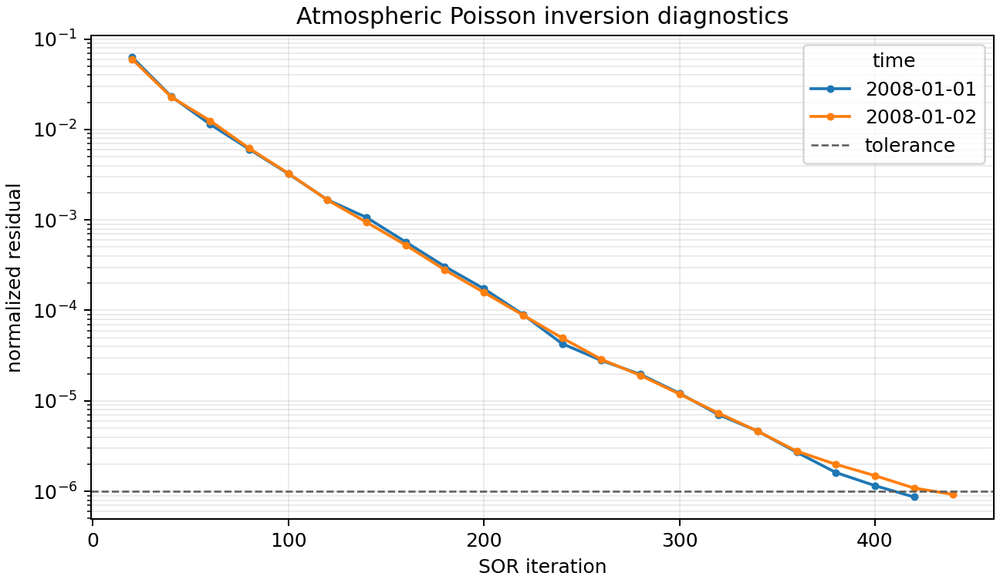

Diagnostic analysis
===================

Xinvert can return the convergence history of every independent inversion as
an ``xarray.Dataset``.  The single ``diag_interval`` parameter both enables this
output and specifies its sampling interval in SOR sweeps.

Enabling diagnostics
--------------------

The default ``diag_interval=0`` returns only the solution and leaves convergence
checking on xinvert's automatic schedule.  Any non-positive integer disables
diagnostic output; a positive integer records the
residual at that interval and changes the return value to
``(solution, diagnostics)``::

    solution, diagnostics = invert_Poisson(
        forcing,
        dims=['lat', 'lon'],
        iParams={
            'tolerance': 1e-6,
            'diag_interval': 20,
        },
    )

Here convergence is checked and recorded after iterations 20, 40, 60, and so
on.  The last iteration is always checked, even when ``mxLoop`` is not an exact
multiple of ``diag_interval``.  A smaller interval gives a denser curve and may
detect convergence earlier, but requires more reductions and, on GPU, more
host-device synchronisations.

Residual and check interval
---------------------------

Xinvert uses the normalized maximum SOR correction as its stopping residual:

.. math::

    r_D = \frac{\max_i |\Delta S_i|}
                {\max_i\max(|S_i^{old}|, |S_i^{new}|)}.

Because an SOR correction satisfies
:math:`\Delta S_i=\omega D_{ii}^{-1}(L(S)-F)_i`, this is a diagonally
preconditioned equation residual.  If the solution scale is zero, xinvert uses
the absolute maximum correction instead.

When ``diag_interval <= 0``, residual checks follow an automatic schedule of
approximately ``mxLoop / 50``, limited to 10--100 sweeps.

When ``diag_interval > 0``, that value is both the residual-check interval and
the diagnostic sampling interval.  The final sweep is always checked.  CPU and
GPU use the same residual definition; on GPU, more frequent checks require
more device-to-host synchronisations.

Diagnostics layout
------------------

For the two-time atmospheric Poisson example used below, ``print(diagnostics)``
produces output of this form::

    <xarray.Dataset> Size: 6kB
    Dimensions:      (time: 2, iteration: 250)
    Coordinates:
      * time         (time) datetime64[ns] 16B 2008-01-01 2008-01-02
      * iteration    (iteration) int64 2kB 20 40 60 ... 4960 4980 5000
    Data variables:
        converged    (time) bool 2B True True
        iterations   (time) int64 16B 420 440
        error        (time, iteration) float64 4kB 0.06304 ... nan nan
        final_error  (time) float64 16B 8.66e-07 9.245e-07
        stop_reason  (time) object 16B 'converged' 'converged'
    Attributes:
        tolerance:       1e-06
        max_iterations:  5000
        diag_interval:   20

The ``iteration`` coordinate gives the SOR sweep at which each residual was
sampled.  ``error`` holds those samples; entries after an individual slice has
stopped are ``NaN``.  ``iterations`` and ``final_error`` provide the last valid
state directly, while ``converged`` and ``stop_reason`` summarize why each
solve ended.

All non-inversion dimensions are retained.  An input
``forcing(member, time, lat, lon)`` therefore produces
``error(member, time, iteration)``.  A single ``(lat, lon)`` input has only the
``iteration`` dimension; xinvert does not invent a ``time`` dimension.

Plotting and derived convergence rates
--------------------------------------

The raw residual history is usually the most useful quantity to plot::

    diagnostics.error.plot.line(
        x='iteration', hue='time', yscale='log',
    )

   Residual histories from ``Data/Helmholtz_atmos.nc`` using the CPU backend,
   ``diag_interval=20`` and ``tolerance=1e-6``.  Each time slice stops
   independently when its sampled residual falls below the dashed tolerance.

A ratio between successive samples is one possible convergence-rate measure::

    rate = diagnostics.error / diagnostics.error.shift(iteration=1)

Xinvert does not store a separate convergence-rate variable because several
definitions are useful in practice and each can be derived from ``error``.

``diag_interval`` versus ``printInfo``
--------------------------------------

Diagnostics are structured, retained after the solve, and suitable for plots,
filtering, serialization, and comparisons across time or ensemble members.
They become available when the inversion result is computed.

``printInfo=True`` instead emits one short text line as each independent solve
finishes.  It does not preserve the iteration history, but can provide an
immediate completion indication during a long batched or Dask calculation.
It is enabled by default; set ``printInfo=False`` when quiet execution or only
structured diagnostics are desired.  The two mechanisms are independent and
may be enabled together when both behaviours are useful.
