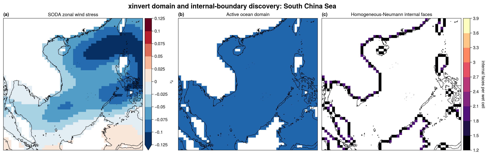

Identifying internal boundaries
===============================

Use these helpers to inspect a two-dimensional mask before setting the
internal boundary conditions described in :doc:`BoundaryConditions`.
``analyze_domain`` identifies connected active regions;
``identify_internal_bcs`` locates their internal active--inactive faces.
They do not perform an inversion or set its boundary conditions.

.. code-block:: python

   import xarray as xr
   from xinvert.domain import analyze_domain
   from xinvert.domain import identify_internal_bcs

   with xr.open_dataset('Data/SODA.nc') as ds:
       field = ds.taux.isel(time=0).load()

   topology = analyze_domain(
       field, dims=('lat', 'lon'), periodic='lon',
       cell_area='spherical',
   )
   coast = identify_internal_bcs(topology)
   topology.plot()
   print(topology.component_stats)
   print(coast.n_directed_faces)

Numeric inputs use non-missing cells as the active mask; boolean inputs use
their values. ``dims`` is ordered ``(y, x)``. Periodic longitude joins the
first and last columns when determining connectivity and coastal faces.

Inspecting the result
---------------------

* ``topology.active``: boolean active-cell mask.
* ``topology.component_labels``: four-neighbour connected-region labels;
  zero denotes inactive cells.
* ``topology.component_stats``: counts and fractions for each region;
  supplying cell areas also adds areas and area fractions.
* ``coast.east``, ``west``, ``north`` and ``south``: masks for active cells
  whose neighbour in that direction is inactive.
* ``coast.faces``: the four masks as a Dataset. Array perimeter faces are
  excluded because they are external boundaries.

Optional filtering returns a new topology and recomputes its boundaries:

.. code-block:: python

   largest = topology.filter_components(keep='largest')
   by_area = topology.filter_components(min_area_km2=5000)
   coast = identify_internal_bcs(largest)

Use ``topology.plot(domain='land')`` or
``topology.plot_histogram(domain='land')`` to inspect the inactive regions.
Here land means the complement of the supplied mask. Filtering this analysis
object does not change the forcing passed to an inversion; apply the
selected active mask to that forcing explicitly when desired.

Explicit masks
--------------

Some model files encode land as zero rather than NaN.  Zero may also be a
valid physical value, so ``analyze_domain`` does not guess that zero means
land.  Supply an explicit boolean mask instead:

.. code-block:: python

   wet_mask = xr.open_dataarray("wet_mask.nc").astype(bool)

   topology = analyze_domain(
       model_field,
       dims=("YG", "XG"),
       periodic="XG",
       valid=wet_mask,
   )

The explicit mask must have boolean dtype and exactly the same dimensions,
shape, and dimension coordinates as the input field.

SODA example
------------

For ``Data/SODA.nc:taux[time=0]``, treating longitude as periodic gives one
connected global ocean component.  The South China Sea detail below is
computed from the full global topology and only then cropped for display.
This is important: analysing a cropped regional array would turn the crop
edges into external boundaries and could change its connectivity.

The complete plotting script is available at
:download:`examples/domain_internal_bcs_scs.py
<../../examples/domain_internal_bcs_scs.py>`.
