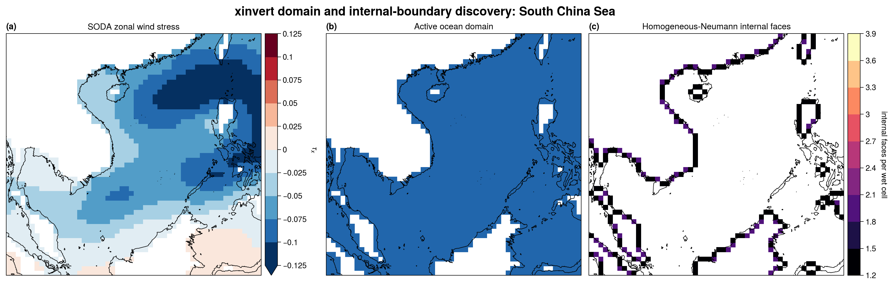

Masked domains and internal boundaries
======================================

``xinvert.domain`` analyses the topology of a static two-dimensional xarray
domain.  ``xinvert.internal_bcs`` then identifies active--inactive faces that
can carry internal boundary conditions.  These modules are currently
preprocessing utilities for independent domain analysis. Normal Poisson
inversion and the supported diagonal second-order applications build topology when
``iParams['internal_bcs'] = 'neumann'``; no user-created object is required.

Quick start
-----------

The simplest input is a two-dimensional numeric ``DataArray`` whose missing
values represent cells outside the domain:

.. code-block:: python

   import xarray as xr

   from xinvert.domain import analyze_domain
   from xinvert.internal_bcs import identify_internal_bcs

   with xr.open_dataset("Data/SODA.nc") as ds:
       taux = ds["taux"].isel(time=0).load()

   topology = analyze_domain(
       taux,
       dims=("lat", "lon"),
       periodic="lon",
   )
   internal_bcs = identify_internal_bcs(topology)

For a numeric array, ``analyze_domain`` uses ``data.notnull()`` as its default
active-cell mask.  For a boolean array, the values themselves are the mask.

The order of ``dims`` is ``(y, x)``.  Periodic dimensions may be supplied by
name, as above, or as two booleans:

.. code-block:: python

   topology = analyze_domain(
       taux,
       dims=("lat", "lon"),
       periodic=(False, True),
   )

``periodic="lon"`` joins the first and last longitude columns both when
labelling components and when constructing directional face masks.

Return value
------------

``analyze_domain`` returns a :class:`xinvert.domain.DomainTopology` object.
Its main fields are:

``active``
   Boolean ``DataArray``.  ``True`` marks active or wet cells.

``component_labels``
   Integer ``DataArray`` with the same grid.  Zero marks inactive cells and
   labels ``1 ... n_components`` identify four-neighbour connected regions.

``n_components``
   Number of connected active regions.

``component_sizes``
   Dictionary mapping each one-based component label to its active-cell count.

``open_east``, ``open_west``, ``open_north``, ``open_south``
   Cell-centred directional masks.  For example, ``open_east[y, x]`` is true
   when the current cell and its eastern neighbour are both active.

``open_faces``
   Convenience ``Dataset`` containing all four directional open-face masks.

The connected-component labels are intended for later component-wise
compatibility checks and null-space constraints.  They do not identify holes
or homology cycles inside a connected component.

Internal boundary result
------------------------

Internal faces are stored in one ``uint8`` ``face_code`` array: bits 0--3
represent east, west, north and south blocked internal faces, and bit 4
marks active cells. Inactive cells have code zero. This is a face bitmask,
not an encoding of arbitrary PDE coefficients or multiple BC kinds.
The directional boolean properties are decoded on demand; accessing
``faces`` allocates all four masks. Keep ``face_code`` for compact storage.

Connected components use SciPy's compiled four-neighbour labelling and a
Numba periodic-seam merge, preserving row-major component numbering.
Component sizes use bounded-block histograms rather than one full-grid scan
per component. Numba's first call includes compilation; reuse topology for
a static mask rather than rebuilding it at every timestep.

``identify_internal_bcs`` constructs a homogeneous Neumann condition by default:

.. code-block:: python

   internal_bcs = identify_internal_bcs(
       topology,
       kind="neumann",
       value=0.0,
   )

It returns an :class:`xinvert.internal_bcs.InternalBoundaryCondition` with:

``east``, ``west``, ``north``, ``south``
   Directional boolean masks.  A true eastern face means that the current
   cell is active, its eastern neighbour is inactive, and the face is inside
   the array domain.

``faces``
   Convenience ``Dataset`` containing all four boundary masks.

``n_directed_faces``
   Total number of active-cell sides adjacent to inactive cells.  A coastal
   cell touching land on two sides contributes two directed faces.

Non-periodic array edges are deliberately excluded.  They belong to
xinvert's existing external-boundary mechanism, whereas these masks describe
only active--inactive interfaces inside the array.

Poisson integration
-------------------

Select the internal boundary condition in ``iParams``:

.. code-block:: python

   from xinvert import invert_Poisson

   solution, diagnostics = invert_Poisson(
       forcing,
       dims=["lat", "lon"],
       iParams={
           "architect": "gpu",  # also 'cpu' or 'cpu-mc'
           "internal_bcs": "neumann",
           "BCs": ["fixed", "periodic"],
           "dtype": "float64",
           "diag_interval": 50,
       },
   )

Each two-dimensional slice derives its active mask from finite forcing
values, excluding the configured numeric ``undef`` if supplied. Dimension
order and periodicity come from ``dims`` and ``BCs``. Masks may change between
time steps; topology is analysed independently at execution time. Dask-backed
batch inputs remain lazy, and compatibility errors may appear at
``compute()``. Inactive values do not enter the Neumann operator.

This path supports Cartesian and nonpolar uniform lat-lon grids, with fixed
or extend y boundaries and fixed, extend or periodic x boundaries. Other
coordinate modes raise explicit errors. CPU-mc and GPU use red-black SOR and
require an even x size when x is periodic; CPU does not have this restriction.
On GPU, coefficients and the iterated field remain device-resident, and
checkpoints download only four scalar metrics. The existing
``icbc`` supplies the initial guess and fixed external boundary values.

For example, with equal Cartesian spacings and an eastern blocked face,
the usual equation is

.. math::

   u_E + u_W + u_N + u_S - 4u_P = h^2 F_P.

A zero-flux internal face removes the whole eastern difference
``u_E - u_P``, giving

.. math::

   u_W + u_N + u_S - 3u_P = h^2 F_P.

Keeping the centre coefficient at -4 would impose fixed zero rather than
zero flux. The same principle applies to weighted spherical conductances.
External extend rows/columns are eliminated as copied ghost values, then
filled in the returned result. Fixed corners take precedence over extend.

For each component not connected to a fixed boundary, the discrete forcing
must be compatible: its sum is zero on a uniform Cartesian grid, or its
``cos(latitude)``-weighted sum is zero for the current spherical stencil.
The check applies to solved unknowns, excluding prescribed fixed cells and
eliminated extend rows. A fixed boundary on another disconnected component
does not remove this requirement. Summation uses float64, allowing a relative
imbalance of ``64 * eps(compute_dtype)`` times the absolute scaled-RHS sum.
An incompatible forcing raises an error naming the component, imbalance and
possible remedies; the solver never silently subtracts a mean.

Compatible unanchored components update every solved cell, without fixing
a special reference point. Checkpoint metrics remove each component's
weighted mean; the final solution is shifted to that zero-mean gauge. This
preserves every physical equation and requires no reference-point selection.
The constant shift is applied once at the end, not on every sweep. For
lat-lon the gauge weights are ``cos(latitude)``; fixed components are never
shifted. Diagnostics report extrema in this output gauge. Isolated solved
cells require zero forcing and return zero. The reported ``error`` remains
the normalized SOR correction, not an independently evaluated equation
residual. Rectangular-grid automatic omega is only a heuristic for an
irregular mask; set ``optArg`` explicitly when assessing convergence.

The default ``internal_bcs='fixed'`` uses finite ``icbc`` values for inactive
neighbours, or zero when unavailable. It does not require topology analysis:

.. code-block:: python

   solution = invert_Poisson(
       forcing, ["lat", "lon"],
       iParams={"internal_bcs": "fixed", "BCs": ["fixed", "periodic"]},
   )

Omitting this setting is equivalent. Inactive iteration values retain finite
``icbc`` boundary values; inactive output is restored to ``undef``.
``icbc`` continues to prescribe valid initial/fixed external values. The
independent topology/BC objects remain useful for inspection, but are not
arguments to the public inversion function.

Supported application families
~~~~~~~~~~~~~~~~~~~~~~~~~~~~~~

The same setting is available on CPU, CPU-mc and GPU for Poisson, PV2D,
Eliassen with ``B=0``, geostrophic, Bretherton--Haidvogel, Fofonoff, and RefState.
The latter two include their existing zero-order reaction terms. The native
coordinate modes of each application still apply; Poisson's internal path
remains Cartesian/nonpolar lat-lon. PV2D and diagonal Eliassen also support
their existing z-lat coordinates.

For a diagonal diffusion/reaction equation, the discrete update is

.. math::

   L_h u_P = \sum_Q g_{PQ}(u_Q-u_P) + q_P u_P = b_P,
   \qquad
   \delta u_P = \omega\,
       \frac{L_h u_P-b_P}{\sum_Q g_{PQ}-q_P}.

Here ``b`` and ``q`` include the same grid-spacing scaling as the existing
application stencil. Closed internal faces remove their complete diffusion
contribution, not the reaction term. Nonzero coercive reaction removes the
constant nullspace: those components do not require zero-net RHS and are
not shifted to zero mean. In general, compatibility uses the **assembled
equation RHS**, not necessarily the original input data (for example Fofonoff
constructs its RHS from model parameters).

Allowed face conductances must be finite, nonzero and have one sign per
component. A uniformly negative diffusion operator is supported without
changing its equation. After this sign normalization, the reaction must be
nonpositive, a sufficient coercivity guarantee. Positive reaction is not
necessarily unsolvable, but requires spectral checks not implemented here.
Degenerate zero faces and sign-changing diffusion raise explicit errors
rather than incorrectly merging independent unknowns.

GillMatsunoFlux and StommelFlux can use this path only in the reduced case
where both non-diagonal coefficients vanish exactly. Their ordinary
non-diagonal tensors, nonzero Eliassen cross terms, first-derivative
general-form equations, 1-D/3-D operators, fourth-order equations and
``animate_iteration`` are not integrated yet; requests fail explicitly.
RefState has a zero RHS; input PV enters the left-hand-side coefficients,
not the forcing. The same diagonal-operator restrictions apply.

Zero operator-normal flux for these scalar equations should not be confused
with zero normal fluid velocity. For a streamfunction, impermeability usually
corresponds to a constant boundary value; use the appropriate physical model
boundary condition rather than choosing internal Neumann solely from a mask.

Explicit masks
--------------

Some model files encode land as zero rather than NaN.  Zero may also be a
valid physical value, so ``analyze_domain`` does not guess that zero means
land.  Supply an explicit boolean mask instead:

.. code-block:: python

   wet_mask = xr.open_dataarray("wet_mask.nc").astype(bool)

   topology = analyze_domain(
       model_field,
       dims=("YG", "XG"),
       periodic="XG",
       valid=wet_mask,
   )

The explicit mask must have boolean dtype and exactly the same dimensions,
shape, and dimension coordinates as the input field.

SODA example
------------

For ``Data/SODA.nc:taux[time=0]``, treating longitude as periodic gives one
connected global ocean component.  The South China Sea detail below is
computed from the full global topology and only then cropped for display.
This is important: analysing a cropped regional array would turn the crop
edges into external boundaries and could change its connectivity.

The figure uses an Ultraplot Mercator projection and high-resolution
coastlines (``coast=True, reso='hi'``).  No land fill, national borders,
rivers, or lakes are drawn.

The complete plotting script is available at
:download:`examples/domain_internal_bcs_scs.py
<../../examples/domain_internal_bcs_scs.py>`.

Current scope
-------------

The first implementation intentionally has a narrow scope:

* static two-dimensional arrays;
* four-neighbour connectivity;
* optional periodic wrapping in either dimension;
* homogeneous Neumann and fixed internal boundaries;
* CPU topology preprocessing;
* automatic supported diagonal 2-D operator integration on all three backends.

Mixed derivatives and fourth-order equations require
additional boundary derivations and validation before integration.
