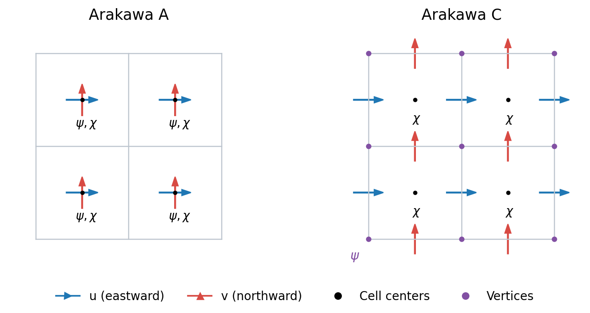

Helmholtz decomposition
=======================

The ``xinvert.helmholtz`` module provides the Helmholtz decomposition of a
given vector field (wind or current) into rotational and divergent components.
Three methods share the same xarray interface: SOR, Forget and Li2006.

Definitions and interface
-------------------------

The **velocity potential** :math:`\chi` generates the irrotational velocity,
and the **streamfunction** :math:`\psi` generates the nondivergent velocity:

.. math::

   \mathbf u=\mathbf u_{\rm rot}+\mathbf u_{\rm div},\qquad
   \mathbf u_{\rm div}=\nabla\chi,\qquad
   \mathbf u_{\rm rot}=\mathbf k\times\nabla\psi.

.. math::

   \nabla\cdot\mathbf u_{\rm rot}=0,\qquad
   \mathbf k\cdot(\nabla\times\mathbf u_{\rm div})=0.

Here :math:`\mathbf k` is the upward unit vector. On a Cartesian grid,
:math:`(u_{\rm rot},v_{\rm rot})=(-\partial_y\psi,\partial_x\psi)` and
:math:`(u_{\rm div},v_{\rm div})=(\partial_x\chi,\partial_y\chi)`.
For velocity in :math:`\mathrm{m\,s^{-1}}`, both potentials have units
:math:`\mathrm{m^2\,s^{-1}}`. Boundary conditions determine the admissible
decomposition; additive constants do not change velocity.

Pass two ``xarray.DataArray`` objects ``u`` and ``v``, with spatial dimensions
in ``dims=[Y, X]`` order. The default accepts both velocities at cell centers
and returns fields on those same coordinates.

* ``decompose`` returns a Dataset with ``urot``,
  ``vrot``, ``udiv`` and ``vdiv``.
  ``return_potentials=True`` adds the available potentials as extra output
  variables and increases memory use.
* ``streamfunction_potential`` returns ``streamfunction`` and
  ``velocity_potential`` for SOR and Li2006.
* ``reconstruct`` returns total ``u`` and ``v`` by summing a component
  Dataset, or differentiating a potential Dataset.

.. code-block:: python

   from xinvert.helmholtz import decompose, reconstruct

   components = decompose(
       u, v, dims=["lat", "lon"], method="li2006", mask=wet,
       iParams={"BCs": ["closed", "periodic"]},
       return_potentials=True,
   )
   velocity = reconstruct(components)

Methods at a glance
-------------------

.. raw:: html

   

.. container:: helmholtz-methods

   .. list-table::
      :header-rows: 1
      :widths: 16 28 28 28

      * - Method
        - SOR
        - Forget
        - Li2006 (default)
      * - Selection
        - ``method='sor'``
        - ``method='forget'``
        - ``method='li2006'``
      * - Definition
        - Two independent Poisson equations.
        - One potential; retain the velocity remainder.
        - Fit both potentials jointly.
      * - Equations
        - :math:`\nabla^2\psi=\zeta`

          :math:`\nabla^2\chi=\delta`
        - :math:`D_hG_h\chi=D_h\mathbf u`

          :math:`\mathbf u_{\rm div}=G_h\chi`

          :math:`\mathbf u_{\rm rot}=\mathbf u-\mathbf u_{\rm div}`
        - :math:`x=(\psi,\chi)`

          :math:`\min_x\,J_\alpha(x)`

          :math:`J_\alpha=\frac12\|Ax-f\|_W^2`

          :math:`\quad+\frac{\alpha}{2}x^TMx`
      * - Algorithm
        - Two SOR inversions.
        - One SOR inversion.
        - Joint least-squares iteration.
      * - Input grid
        - Arakawa A.
        - Arakawa A (default), or C with ``grid='arakawa-c'``.
        - Arakawa A.
      * - Differentiation
        - Arakawa A.
        - Arakawa C; matching divergence and gradient.
        - Arakawa C; joint velocity operator.
      * - Output grid
        - Arakawa A.
        - Same arrangement as input.
        - Arakawa A.
      * - Potentials
        - :math:`\psi` and :math:`\chi`.
        - :math:`\chi` only; no independent :math:`\psi`.
        - :math:`\psi` and :math:`\chi`, both at centers.
      * - Boundaries
        - Fixed, extended or periodic; internal fixed or Neumann.
        - Closed wet region; periodic longitude allowed.
        - Open or closed; periodic longitude allowed.
      * - Velocity sum
        - Can differ from input because the discrete Laplacian and successive
          first derivatives need not match.
        - Equals face input by subtraction; center input also incurs
          interpolation error.
        - Best fit for the chosen penalty; the fitting residual is not
          assigned to either component.
      * - Reference
        - Classical two-Poisson decomposition.
        - `Forget and Ferreira (2019) <https://doi.org/10.1038/s41561-019-0333-7>`_
        - `Li et al. (2006) <https://doi.org/10.1175/MWR3249.1>`_

In the table, :math:`\zeta` and :math:`\delta` are input vorticity and
divergence; :math:`D_h` and :math:`G_h` are matching discrete divergence
and gradient operators. For Li, :math:`x=(\psi,\chi)` contains the
potentials, :math:`Ax` is their velocity and :math:`f` is the input velocity.
With closed boundaries, :math:`W` uses cosine-latitude weights on velocity
faces (area-proportional on a uniform latitude/longitude grid);
Cartesian and open-boundary fits use equal weights.
:math:`M` counts the potential grid points represented by each unknown,
including points sharing a coastal constant.

For center inputs, Forget and Li differentiate internally on the C grid
and interpolate the resulting velocities back to centers.
For Li, reconstructing from the two centered potentials is approximate
and can differ from ``decompose``; use ``decompose`` when velocity components
are needed.

Parameters
----------

**Input and output**

* ``method``: ``'li2006'`` (default), ``'sor'`` or ``'forget'``.
* ``mask``: boolean array, True for wet/active cells.
* ``grid``: ``'arakawa-a'`` (default) or ``'arakawa-c'``
  (Forget only). Values are case-insensitive. Explicit C-grid input uses cell-indexed storage:
  ``u[j, i]`` is the east face and ``v[j, i]`` the north face.
  Returned velocities use physical ``(Y, X_face)`` and ``(Y_face, X)``
  coordinates, shifted by half a grid step; potentials retain ``(Y, X)``.
  See :doc:`Projection` for the input convention.
* ``return_potentials``: False by default; True adds available scalar
  fields to the Dataset and increases memory use.

**Boundary and iteration controls** (in ``iParams``)

* ``BCs``: one entry per spatial dimension. SOR defaults to
  ``['fixed', 'fixed']``; Li defaults to ``['open', 'open']``.
  For closed Li use ``['closed', 'closed']`` or
  ``['closed', 'periodic']``. Periodic longitude must span 360 degrees
  without a repeated endpoint; exact polar rows are unsupported by Li.
* ``internal_bcs``: SOR accepts ``'fixed'`` (default) or supported
  ``'neumann'`` handling for both scalar inversions. This does not select
  Forget: its operators and one-potential construction remain different.
* Forget requires a closed wet region, one eager two-dimensional slice,
  and inactive outer rows/columns in nonperiodic directions.
  Its outer ``BCs`` are ``['fixed', 'fixed']`` or
  ``['fixed', 'periodic']``; wet coasts use Neumann conditions.
  Explicit face input must have zero or NaN blocked normal flux.
  Compatibility and the potential's zero-mean gauge are handled per wet component.

The top-level ``initial=(psi0, chi0)`` supplies the starting potentials for
SOR and Li. For SOR it also supplies prescribed fixed boundary values.
See :doc:`BoundaryConditions` and :doc:`DomainTopology` for boundary details.

**Li fitting coefficient** (in ``mParams``)

* ``alpha``: the coefficient :math:`\alpha` in Li's functional above,
  in :math:`\mathrm{m^{-2}}` for metre-based coordinates. It penalizes
  the amplitudes of **both** potentials. Larger values favor smaller
  potentials, usually increasing velocity error; smaller values favor
  a closer velocity fit but can make the partition more sensitive to
  weakly constrained modes.
* The default ``None`` uses a grid-scaled numerical value. To tune an
  explicit ``alpha``, reduce it by factors of 10 and compare converged
  velocity errors and decomposed fields. Use the same explicit value
  when comparing different grids. Zero is allowed with closed boundaries,
  but leaves constant offsets nonunique.

Error measures and their return format are described in :doc:`Diagnostics`.
See :doc:`Architecture` for CPU and GPU execution controls.
