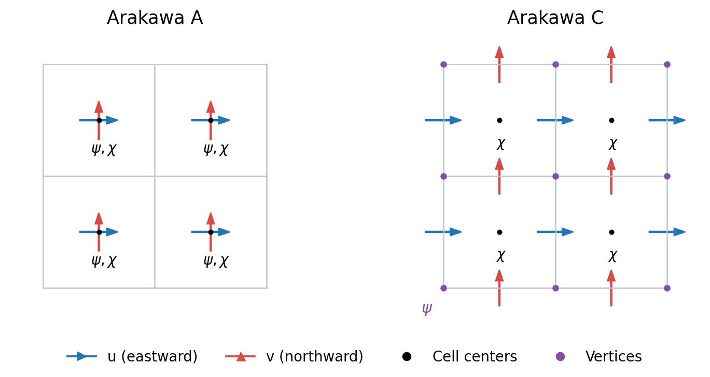

Helmholtz decomposition
=======================

The ``xinvert.helmholtz`` module provides the Helmholtz decomposition of a
given vector field (wind or current) into rotational and divergent components.
Two methods share the same xarray interface: SOR and Li2006.
SOR solves only the velocity potential and subtracts its gradient from the
input velocity; Li2006 fits the streamfunction and velocity potential jointly.

Definitions and interface
-------------------------

The **velocity potential** :math:`\chi` generates the divergent velocity,
and the **streamfunction** :math:`\psi` generates the rotational velocity:

.. math::

   \mathbf u=\mathbf u_{\rm rot}+\mathbf u_{\rm div},\qquad
   \mathbf u_{\rm div}=\nabla\chi,\qquad
   \mathbf u_{\rm rot}=\mathbf k\times\nabla\psi.

.. math::

   \nabla\cdot\mathbf u_{\rm rot}=0,\qquad
   \mathbf k\cdot(\nabla\times\mathbf u_{\rm div})=0.

On a Cartesian grid,
:math:`(u_{\rm rot},v_{\rm rot})=(-\partial_y\psi,\partial_x\psi)` and
:math:`(u_{\rm div},v_{\rm div})=(\partial_x\chi,\partial_y\chi)`.
Boundary conditions determine the admissible decomposition; additive
constants do not change velocity.

Pass ``u`` and ``v`` with spatial dimensions ``dims=[Y, X]`` is enough.
The default accepts both velocities at cell centers and returns fields
on those same coordinates (a.k.a. Arakawa-A grid).

* ``decompose`` returns a Dataset with ``urot``,
  ``vrot``, ``udiv`` and ``vdiv``.
  ``return_potentials=True`` adds the available potentials as extra output
  variables and increases memory usage.
* ``streamfunction_potential`` returns ``streamfunction`` and
  ``velocity_potential`` for Li2006; SOR returns only ``velocity_potential``.
* ``reconstruct`` returns total ``u`` and ``v`` by summing a component
  Dataset, or differentiating a Li2006 potential Dataset.

.. code-block:: python

   from xinvert.helmholtz import decompose, reconstruct

   components = decompose(
       u, v, dims=["lat", "lon"], method="li2006", mask=wet,
       iParams={"BCs": ["fixed", "periodic"]},
       return_potentials=True,
   )
   velocity = reconstruct(components)

Methods at a glance
-------------------

.. raw:: html

   

.. container:: helmholtz-methods

   .. list-table::
      :header-rows: 1
      :widths: 20 40 40

      * - Method
        - SOR
        - Li2006 (default)

      * - Selection
        - ``method='sor'``
        - ``method='li2006'``

      * - Definition
        - One potential; retain the velocity remainder.
        - Fit both potentials jointly.

      * - Equations
        - :math:`D_hG_h\chi=D_h\mathbf u`

          :math:`\mathbf u_{\rm div}=G_h\chi`

          :math:`\mathbf u_{\rm rot}=\mathbf u-\mathbf u_{\rm div}`
        - :math:`x=(\psi,\chi)`

          :math:`\min_x\,J_\alpha(x)`

          :math:`J_\alpha=\frac12\|Ax-f\|_W^2`

          :math:`\quad+\frac{\alpha}{2}x^TMx`

      * - Algorithm
        - One SOR inversion for :math:`\chi`.
        - Joint :math:`\chi` and :math:`\psi` least-squares iteration.

      * - Input grid
        - Arakawa A (default), or C with ``grid='arakawa-c'``.
        - Arakawa A.

      * - Output grid
        - Same arrangement as input.
        - Arakawa A.

      * - Potentials
        - :math:`\chi` only; no independent :math:`\psi`.
        - :math:`\psi` and :math:`\chi`, both at centers.

      * - Boundaries
        - Scalar fixed/extend conditions; periodic longitude allowed.
        - Solid boundaries; periodic longitude allowed.

      * - Velocity sum
        - Equals input by subtraction on the returned grid. Center
          interpolation can still introduce divergence in the remainder.
        - Best fit for the chosen penalty; the fitting residual is not
          assigned to either component.

      * - Reference
        - Poisson equation with matching C-grid operators.
        - `Li et al. (2006) <https://doi.org/10.1175/MWR3249.1>`_

In the table, :math:`D_h` and :math:`G_h` are matching discrete divergence
and gradient operators. For Li2006, :math:`x=(\psi,\chi)` contains the two
potentials, :math:`Ax` is their velocity and :math:`f` is the input velocity.
For Li2006, :math:`W` uses cosine-latitude weights on velocity faces
(area-proportional on a uniform latitude/longitude grid); Cartesian fits
use equal weights.
:math:`M` counts the potential grid points represented by each unknown,
including points sharing a coastal constant.

.. note::
    For center inputs, SOR and Li2006 differentiate internally on Arakawa-C grid
    and interpolate the resulting velocities back to centers.
    For Li2006, reconstructing from the two centered potentials is approximate
    and can differ from ``decompose``; use ``decompose`` when velocity components
    are needed.

Boundary conditions
-------------------

Both methods default to ``BCs=['fixed', 'fixed']``; use
``['fixed', 'periodic']`` for periodic longitude.

**SOR** applies the scalar rules in :doc:`BoundaryConditions` to the velocity
potential: ``fixed`` prescribes its boundary value, while ``extend`` gives
zero normal gradient. The same choice applies at internal coasts through
``internal_bcs``. Fixed potential values alone do not imply an impermeable wall.

**Li2006** treats ``fixed`` as a solid wall: :math:`\partial_n\chi=0` and
:math:`\psi` is constant along each connected coast. Different coastal
constants are determined by the fit, rather than all being set to zero.
Coasts are handled automatically; only longitude can be periodic.
A solid wall is inappropriate at a regional cutoff through which water flows;
Li2006 currently does not implement that open-boundary problem.

Diagnostics
-----------

With ``return_diagnostics=True``, Helmholtz returns ``(result, diagnostics)``.
Both methods retain the solver fields described in :doc:`Diagnostics`:
``error``, ``final_error``, ``converged``, ``iterations`` and ``stop_reason``.

``error`` in Li2006 uses the smaller of its two normalized least-squares
stopping tests. Normal convergence compares it with ``iParams['tolerance']``.
Its definition is also stored in ``diagnostics.error.attrs['definition']``.
The same numerical error does not imply the same reconstructed velocity
accuracy.  So Helmholtz adds two errors, **computed only once after iteration
stops**:

* ``vel_error``: relative L2 error between the input velocity and the sum
  of the rotational and divergent velocities. Dimensionless; 0.01 means 1%.
  SOR forms the rotational velocity by subtraction, so its ``vel_error``
  is near roundoff.
* ``div_error``: root mean square divergence of the rotational velocity,
  in :math:`\mathrm{s}^{-1}`. Its target is zero.

These measure decomposition quality, in addition to the solver convergence.
